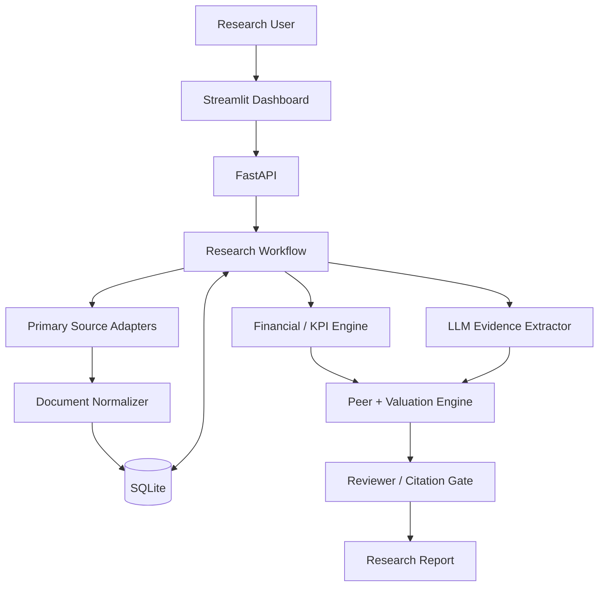
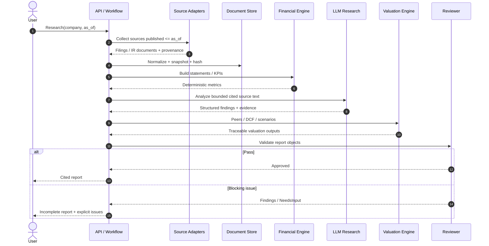
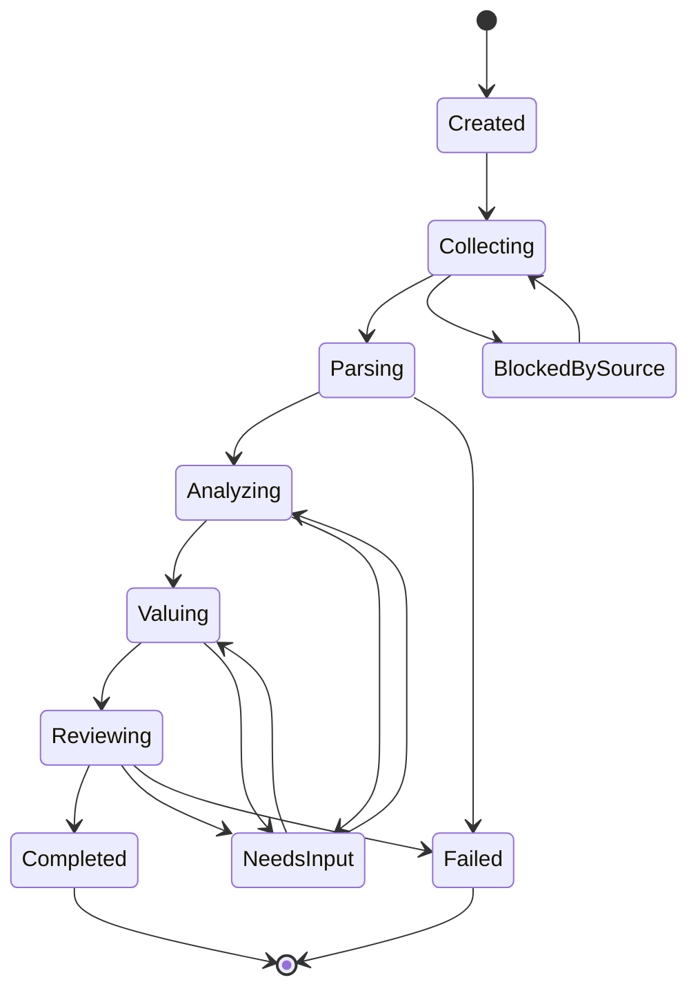
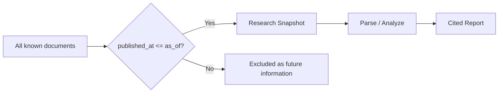
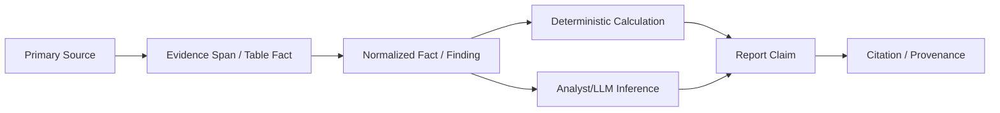
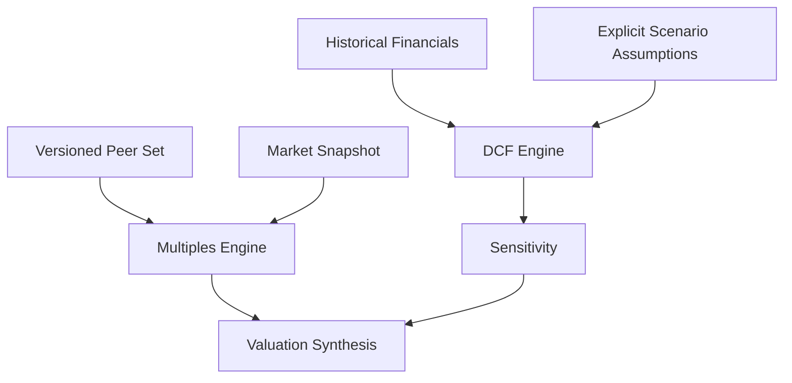

# EquityDesk Diagrams

Mermaid diagrams for architecture, research lifecycle, point-in-time sourcing, and report review.

Related: [ARCHITECTURE](./ARCHITECTURE.md) · [PHASES](./PHASES.md) · [ROADMAP](./ROADMAP.md)

## 1. System Architecture

## 2. End-to-End Research Run

## 3. Research Run State Machine

## 4. Point-in-Time Gate

## 5. Fact → Research Claim Traceability

## 6. Valuation Flow

